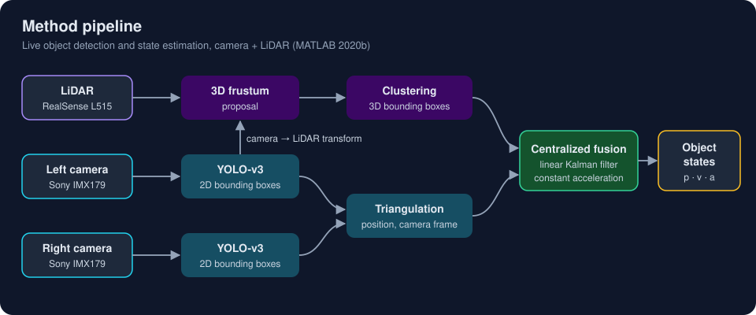
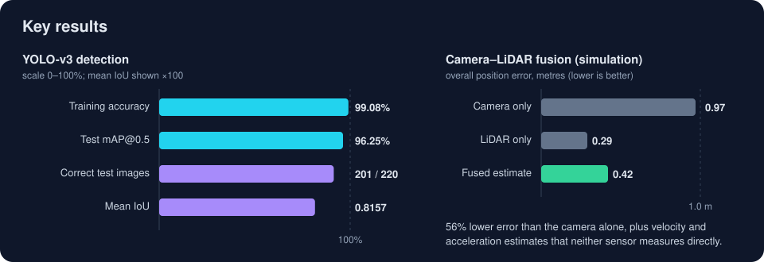

# Real-time Object Detection and State Estimation with YOLO-v3 and Camera–LiDAR Fusion

**LaTeX source of my Master's thesis in Aerospace Engineering, The University of Texas at Arlington (2021).**

A wheeled robot detects objects in real time with a YOLO-v3 deep neural network and estimates each object's position, velocity and acceleration by fusing a stereo camera with a LiDAR through a Kalman filter. The thesis covers the full path from building a labeled dataset and training the detector, through calibrating both sensors, to running detection and fusion live on the robot.

[Defense slides (LaTeX Beamer)](https://github.com/kamalkimahek14/MS-Thesis-Presentation) · [Portfolio: kamal-mehta.com](https://kamal-mehta.com) · [Thesis PDF](MS-Thesis-Report.pdf)

*Thesis title: Object Classification, Detection and State Estimation using YOLO v3 Deep Neural Network and Sensor Fusion of Stereo Camera and LiDAR. Defended June 1, 2021; supervised by Dr. Kamesh Subbarao, Aerospace Systems Laboratory.*

### [Read the thesis (PDF)](MS-Thesis-Report.pdf)

## The problem

A ground robot that avoids collisions has to know **what** is in front of it and **where** it is, many times per second, on a small onboard computer. Region-based detectors such as R-CNN are accurate but too slow for that budget. A camera alone sees classes well but judges distance poorly; a LiDAR measures distance well but sees no color or texture. This work pairs a fast single-shot detector with fusion of both sensors to get accurate, real-time object states, including velocity and acceleration that neither sensor measures directly.

## Approach



1. **Detect** with YOLO-v3, adapted to four shapes (cylinder, traffic cone, pyramid, box) by transfer learning on a labeled dataset of 10,989 images, with anchor boxes estimated by k-means.
2. **Tune** mini-batch size, L2 regularization, learning rate with warm-up and step decay, and number of iterations to balance bias and variance.
3. **Calibrate** the stereo camera (Sony IMX179) and the LiDAR (Intel RealSense L515), intrinsic and extrinsic, to get each sensor's measurement error, its noise covariance and the camera-to-LiDAR transform.
4. **Locate** each object twice: by stereo triangulation of the 2D boxes, and by projecting the boxes into the LiDAR point cloud as 3D frustums and clustering them.
5. **Fuse** both measurements in a centralized linear Kalman filter with a constant-acceleration model, first in a MATLAB driving-scenario simulation and then live on the robot.


## Key results

All numbers come from the thesis (Chapters 2 and 7).

| Result | Value |
|---|---|
| Training accuracy · test mAP@0.5, 4 classes (the thesis table lists both as accuracy) | 99.08% · 96.25% |
| Test images detected correctly | 201 of 220, with no confusion between classes |
| Mean IoU on the test set | 0.8157 |
| Average detection time (test) | 59 ms per frame |
| Mean IoU of the estimated anchor boxes | 0.8738 |
| Camera intrinsic re-projection error | 0.37 pixels |
| Fused position error in simulation | 0.42 m, 56% lower than the camera alone (0.97 m) |
| Sensor rate on the robot | 41 Hz, camera and LiDAR synchronized |
| Training time | 7–8 hours on GPU |



<details>
<summary>Training settings</summary>

| Hyper-parameter | Value |
|---|---|
| Iterations | 11,000 |
| Learning rate | 0.0001 |
| Warm-up period | 500 iterations |
| L2 regularization | 0.0005 |
| Mini-batch size | 10 |
| Train / test split | 98% / 2% |

</details>

<p align="center">
  
  
</p>
<p align="center"><sub>Left: live detections labelled with class, confidence and estimated distance. Right: the test robot with the stereo camera, LiDAR and onboard Intel NUC.</sub></p>

## My contributions

- Transfer learning of YOLO-v3 with SGDM on a custom labeled dataset, including anchor-box estimation.
- Iterative hyper-parameter tuning (L2 regularization, learning rate, mini-batch size, epochs, momentum).
- Evaluation of the trained detector on a held-out test set.
- Intrinsic and extrinsic calibration of the stereo camera and LiDAR: measurement errors, covariances and the rigid transform between the two sensor frames.
- 3D LiDAR boxes derived from the camera labels, so no second neural network is needed for the point cloud.
- A Kalman-filter sensor-fusion framework, tested in simulation and then run in real time on hardware.
- Everything built in MATLAB 2020b (Deep Learning, Computer Vision, Image Processing, LiDAR, and Sensor Fusion and Tracking toolboxes).

## How to build

You need a LaTeX distribution (TeX Live or MiKTeX) with BibTeX. The UTA thesis style files (`utamsASL.sty`, `utaComp.sty`, `psfig.sty`) are included.

```bash
latexmk -pdf Main.tex
```

Without latexmk:

```bash
pdflatex Main.tex
bibtex Main
pdflatex Main.tex
pdflatex Main.tex
```

The output is `Main.pdf`. Packages used: `rotating`, `graphicx`, `amssymb`, `amsmath`, `amsbsy`, `bm`, `subfigure`, `wrapfig`, `mdwlist`, `upgreek`, `multirow`, `enumerate`, `enumitem`, `ulem`, `cite`, `hyperref`, `footnpag`, `placeins`, `algorithm2e`, `float`; bibliography style `IEEEtran`.

> **Linux tip:** one figure is referenced as `Images/LiDARlabel.png` while the file is `Images/lidarlabel.png`. Windows and macOS ignore the case difference; on a case-sensitive file system, copy the file once to the referenced name before building.

## Repository structure

```
MS-Thesis-Report/
├── Main.tex                     # root document: compile this
├── Abstract.tex, Acknowledge.tex, Biography.tex
├── Chapter-Introduction.tex
├── Chapter-Optical-Sensors-and-Object-Detection-Fundamentals.tex
├── Chapter-The-Artificial-Neural-Network.tex
├── Chapter-Supervised-Learning.tex
├── Chapter-Hyper-parameters-Tuning.tex
├── Chapter-Sensor_Fusion.tex
├── Chapter-Results-discussion-and-future-scope.tex
├── appA.tex                     # appendix (not included in the build)
├── references.bib               # IEEEtran bibliography
├── utamsASL.sty, utaComp.sty, psfig.sty   # UTA thesis format
├── Images/                      # figures and result plots (PNG, PDF)
├── docs/                        # README diagrams and photos
└── CITATION.cff
```

## Related

- **[MS-Thesis-Presentation](https://github.com/kamalkimahek14/MS-Thesis-Presentation)**: the defense slides, with the deck presented at the defense in `presented/` and a longer version in `extended/`.
- **[kamal-mehta.com](https://kamal-mehta.com)**: my portfolio.

## Citation

GitHub shows a *Cite this repository* button built from [`CITATION.cff`](CITATION.cff).

Kamal Mehta. *Object Classification, Detection and State Estimation using YOLO v3 Deep Neural Network and Sensor Fusion of Stereo Camera and LiDAR*. Master's thesis, The University of Texas at Arlington, 2021.

## License

[CC BY-NC-ND 4.0](LICENSE): you may read, share and cite this work with credit; no commercial use and no modified versions.
